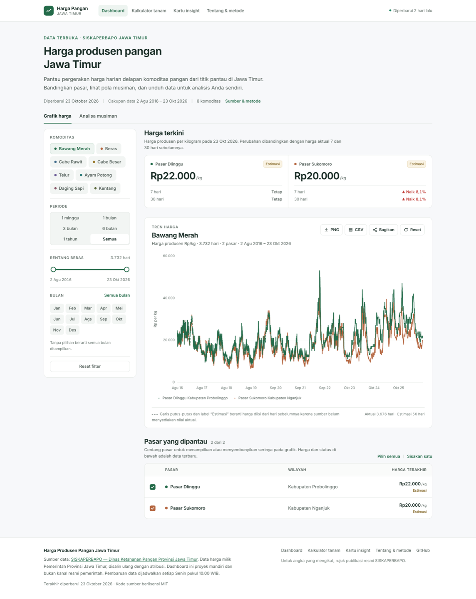
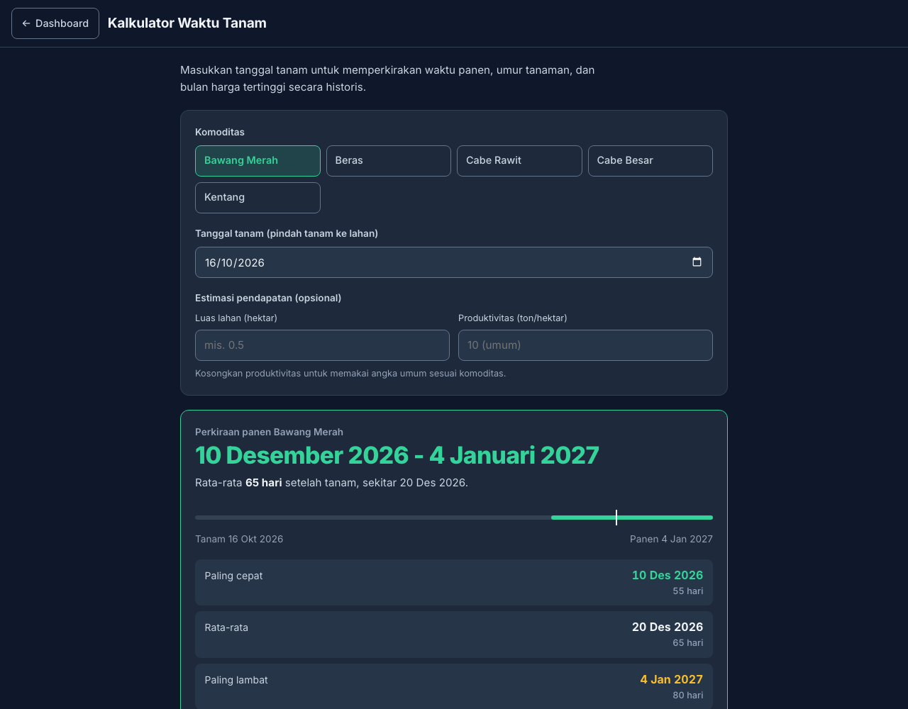

# Harga Produsen Pangan Jawa Timur

Dashboard harga produsen pangan Jawa Timur yang mengambil data dari
[SISKAPERBAPO Jatim](https://siskaperbapo.jatimprov.go.id/produsen/tabel).

Project ini menampilkan tren harga harian beberapa komoditas produsen, memilih
pasar, melihat histori sekitar 10 tahun, dan membaca analisa musiman untuk
membantu petani memahami waktu harga tinggi, rendah, dan momentum kenaikan.



## Fitur

- 8 komoditas produsen:
  - Bawang Merah
  - Beras
  - Cabe Rawit
  - Cabe Besar
  - Telur
  - Ayam Potong
  - Daging Sapi
  - Kentang
- Histori harga harian dari sekitar Agustus 2016 sampai sekarang.
- Chart interaktif dengan zoom, pan, dan drag selection.
- Filter periode preset dan rentang tanggal bebas.
- Pemilihan pasar pada sidebar.
- Pembaruan data dilakukan secara manual dari SISKAPERBAPO.
- Penanda data aktual dan data estimasi carry-forward.
- Analisa tren berdasarkan median harga historis.
- Rekomendasi bulan dengan harga tertinggi, harga terendah, momentum kenaikan,
  konsistensi pola, dan coverage data.
- Kartu harga terkini per pasar dengan penanda estimasi/berhenti, ekspor CSV,
  ekspor grafik PNG, dan tombol bagikan harga via WhatsApp.
- Halaman [Tentang & Metode](tentang.html): sumber data, cara pengolahan, dan
  batasan yang perlu dipahami.
- Generator [Kartu Insight Bulanan](kartu.html): gambar ringkasan 1080×1080
  beserta teks WhatsApp siap dibagikan ke grup.
- Kalkulator waktu tanam: memperkirakan waktu panen dari tanggal tanam beserta
  rata-rata umur tanaman sampai panen.
- Layout desktop dengan sidebar dan toggle sidebar pada mobile.

## Sumber Data

Sumber utama adalah halaman grafik produsen SISKAPERBAPO:

```text
https://siskaperbapo.jatimprov.go.id/produsen/grafik
```

Halaman tersebut menyediakan data sekitar 30 hari untuk komoditas dan pasar
tertentu. Scraper mengambil beberapa rentang tanggal, lalu menggabungkannya
menjadi histori harian.

Data yang tidak tersedia dari sumber dapat diisi menggunakan harga valid hari
sebelumnya agar chart tetap berkesinambungan. Nilai tersebut diberi penanda
`imputed` dan tidak digunakan sebagai data aktual utama dalam analisa.

## Struktur Project

```text
harga-pangan/
├── index.html
├── tanam.html
├── tentang.html
├── kartu.html
├── 404.html
├── site.webmanifest
├── favicon.svg
├── favicon.ico
├── apple-touch-icon.png
├── icon-192.png
├── icon-512.png
├── og-image.svg
├── og-image.png
├── robots.txt
├── sitemap.xml
├── LICENSE
├── assets/
│   ├── screenshot-dashboard.png
│   └── screenshot-tanam.png
├── package.json
├── data/
│   ├── produsen.json
│   ├── analisa.json
│   └── history/
│       └── YYYY/
│           └── YYYY-MM/
│               └── YYYY-MM-DD.json
└── scripts/
    ├── scrape-produsen.js
    ├── bersihkan-data.js
    └── analisa-tren.js
```

### `data/produsen.json`

File agregat yang dibaca dashboard. Isinya mencakup:

- Nama pasar per komoditas
- Harga harian
- Rentang tanggal
- Jumlah hari data
- Penanda data estimasi

### `data/history/`

Arsip harian yang dikelompokkan berdasarkan tahun dan bulan. File ini menjadi
rekaman historis dan tidak menggantikan file hari sebelumnya.

### `data/analisa.json`

Hasil analisa yang dibuat dari `produsen.json` dan digunakan oleh view
`Analisa` pada dashboard.

### Aset & Metadata

- `favicon.svg` adalah sumber ikon; `favicon.ico`, `apple-touch-icon.png`,
  `icon-192.png`, dan `icon-512.png` dihasilkan darinya.
- `og-image.svg` adalah sumber gambar pratinjau sosial; `og-image.png`
  (1200x630) dihasilkan darinya dan dirujuk oleh meta Open Graph/Twitter.
- `site.webmanifest` mendaftarkan ikon dan nama aplikasi untuk PWA.
- `robots.txt`, `sitemap.xml`, dan `404.html` memakai base URL yang sama dengan
  canonical.
- Screenshot README di `assets/` diambil dari situs yang berjalan.
- Canonical URL, `og:url`, `og:image`, dan URL di `robots.txt`, `sitemap.xml`,
  serta `404.html` mengarah ke `https://zeinzulaziz.github.io/harga-pangan/`.
  Jika dashboard dipindah ke domain custom, ganti nilai tersebut sekaligus di
  `index.html`, `tanam.html`, dan file-file tadi.

## Kalkulator Waktu Tanam



Halaman `tanam.html` memperkirakan waktu panen berdasarkan komoditas dan
tanggal tanam yang dipilih, lalu menampilkan rentang panen paling cepat,
rata-rata, dan paling lambat beserta rata-rata umur tanaman. Perkiraan umur
tanaman yang dipakai:

- Bawang Merah: 55–80 hari (rata-rata 65)
- Beras: 95–125 hari (rata-rata 110, belum termasuk persemaian)
- Cabe Rawit: 70–90 hari (panen pertama)
- Cabe Besar: 75–95 hari (panen pertama)
- Kentang: 85–120 hari (rata-rata 100)

Halaman ini juga menampilkan bulan dengan harga tertinggi dan terendah secara
historis dari `analisa.json` sebagai pertimbangan jadwal tanam. Nilai tersebut
adalah perkiraan umum, bukan jaminan hasil panen.

## Kartu Insight Bulanan

Halaman [`kartu.html`](kartu.html) menggambar kartu ringkasan harga semua
komoditas (1080×1080) langsung di browser dari `data/produsen.json`. Alur pakai:

1. Buka `kartu.html` lewat static server.
2. Klik **Unduh PNG**, lalu **Salin teks** WhatsApp pendamping.
3. Bagikan gambar + teks ke grup WhatsApp.

Kartu memakai harga aktual terakhir tiap komoditas. Komoditas yang sumbernya
sudah lama berhenti mengisi (mis. Kentang sejak Januari 2023) ditandai
"data berhenti &lt;bulan tahun&gt;" alih-alih ditampilkan sebagai harga terkini.

## Menjalankan Lokal

Project membutuhkan Node.js. Tidak ada dependency npm tambahan.

```bash
npm run scrape
npm run bersihkan
npm run analisa
```

Karena browser membatasi `fetch` pada file lokal, jalankan static server untuk
membuka dashboard:

```bash
python3 -m http.server 8000
```

Kemudian buka:

```text
http://localhost:8000
```

## Scraper

### Mode Harian

Mode harian mengambil data terbaru, menggabungkannya dengan `produsen.json`,
dan menyimpan arsip ke `data/history/`.

```bash
npm run scrape
```

Mode ini dijalankan secara manual untuk memperbarui data terbaru dari
SISKAPERBAPO.

### Backfill Historis

Mode full mengambil banyak rentang 30 hari untuk membangun histori. Data lama
tetap dipertahankan dan hasil baru di-merge.

```bash
npm run scrape:full
```

Jumlah request dapat diatur melalui `BACKFILL_REQUESTS`:

```bash
BACKFILL_REQUESTS=66 npm run scrape:full
BACKFILL_REQUESTS=131 npm run scrape:full
```

Nilai sekitar 66 request per komoditas mencakup kurang lebih 5 tahun, sedangkan
131 request mencakup kurang lebih 10 tahun dengan interval request 28 hari.

### Analisa

```bash
npm run analisa
```

Analisa menggunakan data aktual yang tersedia. Data carry-forward yang diberi
penanda `imputed` dikecualikan dari perhitungan utama.

Hasil analisa meliputi:

- Median dan rata-rata harga per bulan kalender
- Bulan dengan harga tertinggi
- Bulan dengan harga terendah
- Momentum kenaikan dan penurunan
- Konsistensi arah perubahan antar tahun
- Coverage data dan jumlah hari aktual/estimasi
- Perbandingan tahun berjalan dengan tahun sebelumnya

## Update Data

Pembaruan data dilakukan secara manual dari SISKAPERBAPO. Setiap kali ingin
memperbarui data:

```bash
npm run scrape && npm run cek && npm run bersihkan && npm run analisa
```

1. `npm run scrape` mengambil data terbaru dari SISKAPERBAPO, menggabungkannya
   dengan `produsen.json`, dan menyimpan arsip ke `data/history/`.
2. `npm run cek` menampilkan kandidat salah input (spike satu hari 1,5x-4x yang
   tidak dihapus otomatis). Hanya membaca data; tinjau hasilnya sebelum
   menambahkan koreksi.
3. `npm run bersihkan` menghapus data tidak normal dan menerapkan koreksi manual
   yang terdaftar di `scripts/bersihkan-data.js`. Langkah ini wajib dijalankan
   setelah `scrape` karena `scrape` dapat menimpa kembali nilai yang sudah
   dikoreksi dengan data salah dari sumber.
4. `npm run analisa` menghitung ulang `data/analisa.json`.
5. Commit dan push perubahan ke repository agar dashboard diperbarui.

## Catatan Data

- SISKAPERBAPO dapat terlambat mengisi data tanggal terbaru.
- Nama atau jumlah pasar dapat berubah dari waktu ke waktu.
- Data carry-forward hanya digunakan agar chart tidak terputus, bukan sebagai
  bukti harga aktual.
- Rekomendasi adalah analisa historis, bukan jaminan harga masa depan.
- Faktor cuaca, produksi, hari raya, pasokan, biaya produksi, dan permintaan
  belum dimasukkan ke model.

## Teknologi

- HTML, CSS, dan JavaScript vanilla
- Chart.js
- chartjs-plugin-zoom
- Node.js untuk scraper dan analisa
- GitHub Pages untuk hosting dashboard

## Lisensi

Kode di repository ini berlisensi [MIT](LICENSE). Data harga berasal dari
SISKAPERBAPO Pemerintah Provinsi Jawa Timur; hak atas data tetap milik sumber
dan dashboard ini bukan kanal resmi.
